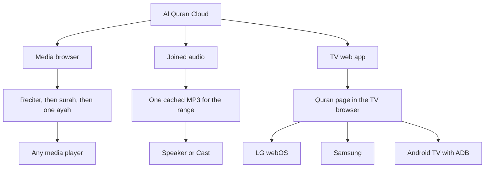
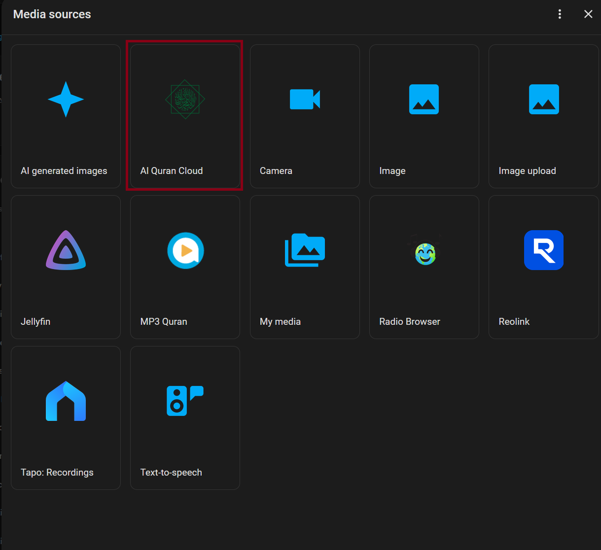
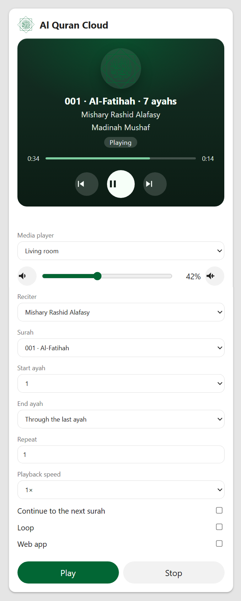
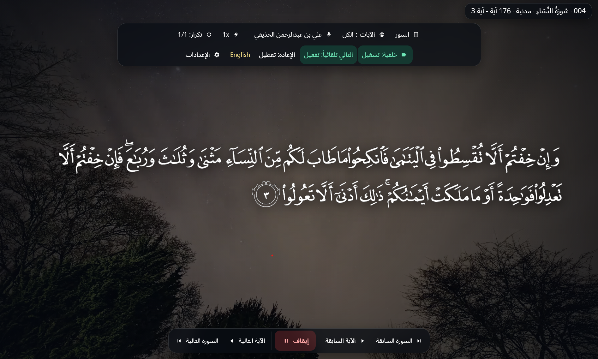

<a href="https://alquran.cloud/"></a>

# Al Quran Cloud for Home Assistant

Put the passage you are working on onto a speaker or the living-room TV, then get on with the rest of the day. Pick a surah or a few ayahs, set how many times they repeat, and let Home Assistant start that recitation when you cook, drive, review homework, or sit with a child who is memorizing. The same passage can loop, or a full surah can move on by itself. A speaker plays one joined recording. The TV page opens on an LG webOS set, a Samsung TV, or an Android TV added with the Android Debug Bridge integration, and that page shows the ayah. This does not quiz anyone or keep a memorization score. It keeps the recitation playing on the device you already use.

This project is an independent Home Assistant integration. It is not affiliated with, endorsed by, or maintained by [Al Quran Cloud](https://alquran.cloud/) or the [Islamic Network](https://islamic.network/). The mark at the top is theirs. Recitations, ayah pictures, and the catalog come from their public API and [CDN](https://alquran.cloud/cdn). Each reciter keeps the rights in their own recording.

<p>
  <a href="https://hacs.xyz/"></a>
  &nbsp;
  <a href="https://my.home-assistant.io/redirect/hacs_repository/?owner=modestpharaoh&repository=hass-alquran-cloud&category=integration"></a>
</p>

Play on a Home Assistant media player, including a Cast speaker, browse one ayah under Media, or hand a surah to a TV browser. The domain is `alquran_cloud`. Reciter ids are edition strings such as `ar.alafasy`.

## Three ways to play

The integration adds **Al Quran Cloud** to the media browser, in the same list as Radio Browser. It also joins a passage for a speaker, and it can open the Quran page on a TV.



**Media browser.** Open **Media**, then **Al Quran Cloud**. Pick a reciter, then a surah, then an ayah such as `001:001`. Home Assistant plays that one MP3 from the Al Quran Cloud CDN, for example `https://cdn.islamic.network/quran/audio/128/ar.alafasy/1.mp3`. Favorite reciters are listed first and marked with a star. This path does not join a range, repeat it, or open the TV page.



**Joined audio.** The card or `alquran_cloud.play`, with the web app off, downloads the ayahs in the range and joins them into one cached file. That file plays on any media player, including a Cast speaker.

**TV web app.** The same play action with the web app on opens the bundled Quran page on an LG webOS set, a Samsung TV, or an Android TV added with the Android Debug Bridge integration. Home Assistant does not build an MP4. The page shows the ayah and reports the reciter, surah, and ayah back to the card. The Android TV Remote integration does not open this page.

<br clear="right">

## A passage on a schedule

An automation can start the range you are reviewing. This one plays Al-Mulk 1–5 ten times on the kitchen speaker at 7:00. Change the player, the surah, and the count to the passage you or your child are on this week.

```yaml
automation:
  - alias: Morning Quran passage
    triggers:
      - trigger: time
        at: "07:00:00"
    actions:
      - action: alquran_cloud.play
        target:
          entity_id: media_player.kitchen
        data:
          reciter_id: ar.alafasy
          surah: 67
          start_ayah: 1
          end_ayah: 5
          repeat: 10
          speed: 1
          loop: false
          webapp: false
```

For a TV, set `webapp: true` and target an LG webOS set, a Samsung TV, or an Android TV entity from the ADB integration. `continue_surah: true` on a full surah opens the next surah when the current one ends. `loop: true` starts the same passage again.

## Docs

- [Integration architecture](docs/integration.md) — audio join, TV handoff, cache, and why Chromecast is not a video target
- [Quran player](docs/kiosk.md) — the page Home Assistant serves to the TV, including webOS 4
- [Dashboard card](docs/card.md) — the Lovelace card, player list, and web app controls

## Install

### HACS

<a href="https://hacs.xyz/"></a>
<a href="https://my.home-assistant.io/redirect/hacs_repository/?owner=modestpharaoh&repository=hass-alquran-cloud&category=integration"></a>

1. Open **HACS → Integrations → ⋮ → Custom repositories**.
2. Add `https://github.com/modestpharaoh/hass-alquran-cloud` as category **Integration**.
3. Install **Al Quran Cloud** and restart Home Assistant.
4. Go to **Settings → Devices & services → Add integration → Al Quran Cloud**.

### Copy the folder

1. Copy `custom_components/alquran_cloud` into your Home Assistant `config/custom_components/alquran_cloud` folder.
2. Restart Home Assistant.
3. Add the **Al Quran Cloud** integration.

If an older `quran_com` folder is already installed, remove that folder and add this integration again.

Add a dashboard card:

```yaml
type: custom:alquran-cloud-card
entity: media_player.living_room
reciter_id: ar.alafasy
surah: 1
start_ayah: 1
repeat: 1
speed: 1
webapp: false
background_video: false
```



The card is also added to Settings → Dashboards → Resources when Lovelace uses storage mode. The resource URL includes the version from `manifest.json`, so a version bump refreshes the card.

`ffmpeg` and `ffprobe` are required for joined audio at any speed other than 1, and for probing duration. Joined audio also needs an HTTPS Home Assistant URL. The TV page can use the internal `http://` URL.

## What it plays

The public Al Quran Cloud API lists the free Arabic verse-by-verse recitations. The integration loads that list. Each reciter’s bitrate comes from the API, then every ayah MP3 is built from the global ayah number.

The play action does not stream those ayah files one by one. It builds one cached MP3 for the range, under `.cache/alquran_cloud/audio/`. **Joined audio cache (days)** decides how long that file is kept. The default is 7 days. Playing it again refreshes that age. The first build of a long surah can take several minutes. A notification stays up while ffmpeg works.

Speeds other than 1 are written into the cached audio file. Repeat plays that file the requested number of times. Continue to the next surah is available only for a full surah. Loop starts the original surah or range again, and it is off unless you turn it on. While a speaker is playing, the card shows the requested range, such as `001:005`, or the surah line with its ayah count when the range runs through the last ayah. Names and labels follow the integration display language, Arabic or English. The volume row sits under the media player and shows the level, such as `42%`, just before the increase button.

## Web app on a TV



The web app runs in the TV’s own browser. Home Assistant can open it on these sets:

| Set | Integration | How the page opens |
| --- | --- | --- |
| LG webOS, including older sets on Chromium 53 | `webostv` | `webostv.command` runs `system.launcher/open` |
| Samsung Tizen, and the older Smart TV browser | `samsungtv`, `samsungtv_smart`, `samsungtv_tizen` | The media player opens the address in the TV browser |
| Android TV and Fire TV | `androidtv`, the Android Debug Bridge integration | `androidtv.adb_command` starts the browser with the address |

The Android TV Remote integration does not open this page. Add the set with the ADB integration.

Turn on **Web app**. Home Assistant opens `/api/alquran_cloud/kiosk/` in that browser with the reciter, surah, ayah range, speed, repeat, continue, loop, and background video in the address. The TV then owns playback. The page reports the reciter, surah, and ayah, and the card shows that last report. Sync asks for it again. Play, pause, previous ayah, next ayah, previous surah, and next surah reach the page on every TV. The TV going idle does not end the session. `background_video` defaults to off. Turn it on to play the landscape clip behind the page. It does nothing for joined audio. The card shows that switch only while **Web app** is on.

The player list in that mode contains only those TVs (`webostv`, Samsung, and `androidtv`), in alphabetical order. Chromecast stays on the audio list. A Chromecast with Google TV can open the page when that device is also added with the Android TV ADB integration.

The page was rebuilt for the limited browsers on LG webOS and Samsung. The script the TV loads is compiled down to Chrome 53, with a few missing DOM calls filled in, so a webOS 4 set from around 2018 can run it. Arabic is drawn with a bundled Noto Sans Arabic font, because the TV font splits words such as السور and الإعدادات. Buttons are inline SVG, because those sets have no emoji font. On webOS 4, 5, and 6, and on Samsung sets from before Tizen 6.5, the background is a series of still pictures and playback stays at 1×. Those browsers can decode only one media stream, so a video behind the ayah audio stops after a few seconds, and their decoder ignores other speeds. A newer browser, including Android TV, still gets the 1080p clip and the other speeds. Details are in [Quran player](docs/kiosk.md).

The address uses the internal Home Assistant URL when one is set. `http://` is enough for the page. The page has no login, and it opens only from loopback or from a subnet on an enabled Home Assistant network adapter. **Also allow private addresses** opens it to other private LANs. **Extra trusted subnets** adds CIDRs such as `192.168.50.0/24`. A Docker bridge install whose only adapter is `172.17.0.0/16` needs one of those before a `192.168` TV can open the page. Audio and ayah pictures are loaded by the TV from `cdn.islamic.network`. In web app mode the card’s play, pause, ayah, and surah buttons call `alquran_cloud.transport` on every TV. The `next_surah` and `previous_surah` actions still open the neighboring full surah.

## Actions

`alquran_cloud.play` takes every playback option. Leave `end_ayah` out to run through the last ayah of the surah. `continue_surah` applies only to a full surah. `loop` defaults to off. For joined audio it replays the original surah or range. For the web app it is sent as `loop` and the page shows a matching button. `speed` is one of `0.5`, `0.75`, `1`, `1.25`, `1.5`, `1.75`, or `2`. `repeat` is 1–20. `background_video` defaults to false and is used only by the web app.

```yaml
action: alquran_cloud.play
target:
  entity_id: media_player.living_room
data:
  reciter_id: ar.alafasy
  surah: 2
  start_ayah: 1
  end_ayah: 5
  repeat: 2
  speed: 1
  continue_surah: false
  loop: false
  webapp: false
  background_video: false
```

The same action opens the TV web app when `webapp` is true. Use an LG webOS entity, a Samsung entity, or an `androidtv` entity from the ADB integration. `loop: true` turns on the page’s loop button. `background_video: true` plays the landscape clip on a browser that can show it. On older LG webOS and Samsung sets the page shows still pictures instead.

```yaml
action: alquran_cloud.play
target:
  entity_id: media_player.living_room_tv
data:
  reciter_id: ar.alafasy
  surah: 2
  start_ayah: 1
  end_ayah: 5
  repeat: 2
  speed: 1
  continue_surah: false
  loop: false
  webapp: true
  background_video: false
```

`alquran_cloud.transport` sends one command to the page that is already open. It does not reload the page and it does not open a new surah. `command` is `play`, `pause`, `previous_ayah`, `next_ayah`, `previous_surah`, `next_surah`, or `report`. The ayah and surah commands step one ayah or one whole surah. `next` and `previous` still follow the ayah-or-surah choice saved on the TV. `report` asks the page for the current reciter, surah, and ayah and leaves the clip where it is. The card uses this action for its six buttons and for Sync.

```yaml
action: alquran_cloud.transport
target:
  entity_id: media_player.living_room_tv
data:
  command: next_ayah
```

Stop, next, and previous use the player from the current session. Next and previous open the neighboring full surah with the same repeat, speed, web app, and background setting.

```yaml
action: alquran_cloud.stop
target:
  entity_id: media_player.living_room
```

```yaml
action: alquran_cloud.next_surah
target:
  entity_id: media_player.living_room
```

```yaml
action: alquran_cloud.previous_surah
target:
  entity_id: media_player.living_room
```

The cache actions have no target and no fields.

```yaml
action: alquran_cloud.clear_cache
```

```yaml
action: alquran_cloud.clear_audio_cache
```

```yaml
action: alquran_cloud.clear_video_cache
```

```yaml
action: alquran_cloud.clear_source_cache
```

`clear_cache` deletes joined audio, leftover videos and pictures, downloads, and work files. `clear_audio_cache` deletes joined MP3s only. `clear_video_cache` deletes leftover surah videos and downloaded ayah pictures. `clear_source_cache` deletes downloaded ayah MP3s and unfinished work files.

Starting the integration also deletes leftover surah videos and ayah pictures. `sensor.al_quran_cloud_active_sessions` lists the reciter, surah, and requested range, and its `display_language` attribute is `english` or `arabic`. A stop button appears for each player that has been used.

## Manual check

- [ ] Speaker, web app off, speed 1: one cached MP3 of the surah or range plays, then stops.
- [ ] Speed 0.5 and 1.75 on a speaker that can open the Home Assistant HTTPS URL.
- [ ] Web app on the card lists only LG, Samsung, and Android TV players, sorted by name. Loop stays visible. Background video appears only in that mode and starts off.
- [ ] `background_video: true` opens the web app with the landscape clip playing. The default leaves it hidden.
- [ ] `continue_surah: true` on a full surah opens with auto-next on and moves to the next surah. `auto_surah=false` leaves that button off and stops at the end.
- [ ] `loop: true` turns the web app loop button on. Off leaves it off.
- [ ] LG, Samsung, or Android TV opens the player on the requested reciter and ayah range. The card hides that surah and reciter, and its next and previous buttons send track commands.
- [ ] A second audio play of the same reciter and range starts without building the file again.
- [ ] webOS 4 shows the bismillah image, fills the surah, and plays audio after a remote key if the TV blocked autoplay.

## Tests

```bash
python3 -m venv .venv
.venv/bin/pip install -r requirements-dev.txt
npm install
.venv/bin/python -m pytest tests/ -q
```

`requirements-dev.txt` installs `pytest`, `pytest-asyncio`, `aiohttp`, and `voluptuous`. `npm install` installs the esbuild used to check the TV page’s Chrome 53 scripts. No Home Assistant install is required.
