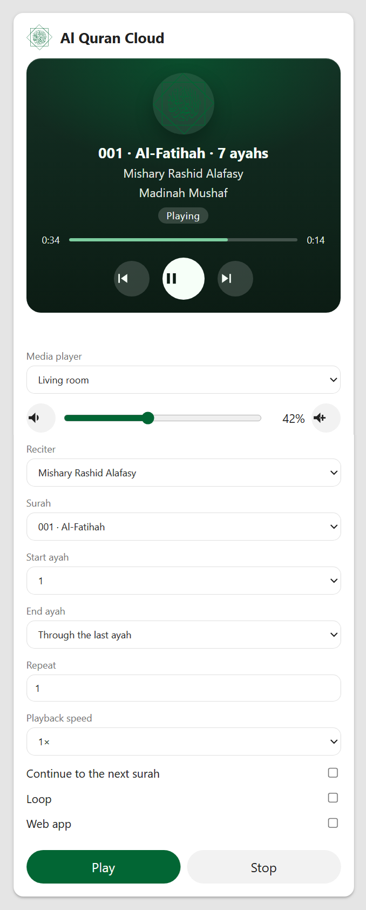

# Dashboard card



`www/alquran-cloud-card.js` defines `alquran-cloud-card` and `alquran-cloud-card-editor`. Lovelace type: `custom:alquran-cloud-card`.

Home Assistant registers it as `/alquran_cloud/alquran-cloud-card.js?v=<manifest version>` when Lovelace storage resources are available. The version query is how a browser drops an old card after a bump in `manifest.json`. The brand icon is served from `/alquran_cloud_brand/`.

The card speaks the integration’s display language, read from the active-sessions sensor. Arabic shows Arabic labels and names. English shows English labels and names. The TV player receives the same language.

## Config

```yaml
type: custom:alquran-cloud-card
entity: media_player.living_room
reciter_id: ar.alafasy
surah: 1
start_ayah: 1
end_ayah: 7
repeat: 1
speed: 1
continue_surah: false
loop: false
webapp: false
background_video: false
```

| Field | Role |
| --- | --- |
| `entity` | Media player. In web app mode this must be a supported TV. |
| `reciter_id` | Al Quran Cloud edition id. |
| `surah` | 1–114. Changing reciter or surah resets the range to the full surah. |
| `start_ayah` | First ayah. Default 1. |
| `end_ayah` | Last ayah. Empty means through the last ayah. |
| `repeat` | 1–20. Plays the whole selected range that many times, not one ayah at a time. |
| `speed` | 0.5, 0.75, 1, 1.25, 1.5, 1.75, or 2. Older LG webOS and Samsung sets before Tizen 6.5 stay at 1×. |
| `continue_surah` | Shown only for a full surah. Ignored for a range. |
| `loop` | Off unless set. Replays the original surah or range. Sent to the web app as `loop`. |
| `webapp` | Opens the Quran web app on a TV instead of playing a joined MP3. |
| `background_video` | Landscape clip behind the web app. Hidden unless `webapp` is on. Defaults to false. |

Play calls `alquran_cloud.play` with those fields. Pause, resume, and volume use the media player’s own services when the player supports them. In audio mode, next and previous call `alquran_cloud.next_surah` and `previous_surah`. In web app mode, previous surah, previous ayah, play, pause, next ayah, and next surah call `alquran_cloud.transport` on every TV. Sync calls `alquran_cloud.transport` with `report`. Stop calls `alquran_cloud.stop`.

Reciters and surahs are loaded from the `media-source://alquran_cloud` catalog, the same tree as the media browser. Favorites saved in the integration options come first.

## Player list

Every listed player is shown by `friendly_name`, sorted with `localeCompare`. Entity id is the fallback label.

With **Web app** off, the list keeps speakers that can play a Home Assistant stream: `supported_features` includes play media, and the platform is not `webostv`, `samsungtv`, `samsungtv_smart`, `samsungtv_tizen`, or `androidtv`. Chromecast stays in this list when it can play the joined MP3.

With **Web app** on, the list keeps only these platforms, read from `hass.entities[id].platform`:

- `webostv`
- `samsungtv`
- `samsungtv_smart`
- `samsungtv_tizen`
- `androidtv`

`cast` is not in that TV list. Chromecast can play the joined MP3, and it can show a Lovelace dashboard, but it cannot open this player URL. See [Integration architecture](integration.md).

If the saved `entity` is not one of those TVs, the select is cleared and the card says to choose an LG, Samsung, or Android TV. Turning the web app off clears a saved TV and says to choose a speaker.

Playback settings sit under the stage, under the heading Playback Settings / إعدادات التشغيل. Continue, Loop, Web app, and Background video are outlined switch cards: the icon and label lead, and the switch follows. A switch is green while on and grey while off. Background video is shown only while Web app is on. Stop and Play follow that note, then the media player and volume, then reciter and surah. From ayah and To ayah share one row. Repeat count and playback speed share the next row. Two short notes under that row say that repeat covers the whole range, and that older LG webOS and Samsung TVs stay at 1×.

## While it plays

In audio mode the stage shows the brand mark, the surah line, the reciter, and the Madinah mushaf line when the session has an album. Continue, Loop, and Repeat change the running speaker session immediately. The play already in progress finishes at its current speed. The chosen speed is used when that range repeats or when the next surah starts.

The card speaks the integration’s display language, from `display_language` on the active-sessions sensor. It does not follow the Home Assistant locale. A surah is named with its number, name, ayah count, and Meccan or Medinan, such as `108 · Al-Kawthar · 3 ayahs · Meccan` and `002 · سُورَةُ البَقَرَةِ · 286 آية · مدنية`. The Surah dropdown and the stage use that line. The Arabic count word follows the last two digits: 3–10 is آيات, 2 is آيتان, and every other ending is آية. English uses ayahs. In Arabic the previous control points right and the next control points left. Audio mode shows the range that was requested, not the ayah under the playhead. A partial range adds the ayahs after that title, such as ` · 001:005`. The card reads that session from `sensor.al_quran_cloud_active_sessions`. While a session is active, the reciter and surah selectors follow it, including a surah change on a speaker and a reciter or surah change reported by the TV. From ayah then starts at ayah 1 of that surah, and To ayah runs through its last ayah. Those choices are not saved. Stop, or a refresh after stop, shows the reciter, surah, and ayah range saved on the card. The progress bar still advances once a second from `media_position`. When that player supports seek, clicking or dragging the bar calls `media_seek`. When playback moves to another surah, the sensor title changes immediately, before the next joined file is finished. Pause is available when the player supports play or pause.

A power button sits at the end of the media player row. It calls turn on when the player is off, standby, unknown, or unavailable, and turn off for any other state. It stays hidden when that action is not supported. The volume row is directly under the media player when that player reports a level or supports volume. The percent, such as `42%`, sits just before the increase button. Plus, minus, and the slider all update that number together.

Web app mode hides the progress bar and the mushaf line. The stage shows the standard surah line from the last report, with the current ayah at the end, such as `001 · Al-Faatiha · 7 ayahs · Meccan · Ayah 2` and `001 · سُورَةُ ٱلْفَاتِحَةِ · 7 آيات · مكية · آية 2`. Before that first report it shows the surah that was opened, with its starting ayah. Playing or paused comes from that report. The status pill is green while the page is playing, amber while it is paused, and red when the page is not reporting. One row holds previous surah, previous ayah, play, pause, next ayah, and next surah. Arabic reverses that row. Hover shows the name. Those six buttons call `alquran_cloud.transport` on LG webOS, Samsung, and Android TV. They step one ayah or one surah and do not follow the page’s remote setting. Sync sits at the top corner, on the right in English and on the left in Arabic. It asks the page to send the current values and does not change playback. If the page does not answer within a few seconds, the card says so and the pill turns red. The last report stays until Stop. A physical remote’s media keys work on Android TV and often do not arrive on LG webOS or Samsung. Volume controls stay if the entity supports volume.

While the page is open, Continue, Loop, Background video, Repeat, and Playback Speed follow the page. Changing one on the card calls `alquran_cloud.transport` with `settings`, and the page applies it without reloading. Changing it on the page updates the card on the next report. Continue stays available for that open page even when the card’s ayah range is only part of a surah. Loop replays the original range, and replays from surah 1 when Continue is also on. Older LG webOS and Samsung sets keep speed at 1×.

## Decisions

- One card for both modes. `webapp` switches the player list and which controls are visible.
- Players are alphabetical in both modes.
- Web app mode never offers a speaker or a Chromecast. A saved non-TV entity is dropped rather than sent to a player that cannot open the page.
- The card shows the reciter, surah, and ayah the page last reported. It does not estimate an ayah from a media position.
- In web app mode the stage offers previous surah, previous ayah, play, pause, next ayah, next surah, and Sync.
- Progress belongs to the joined MP3, not to the TV page. Audio mode keeps one button that switches between play and pause.
