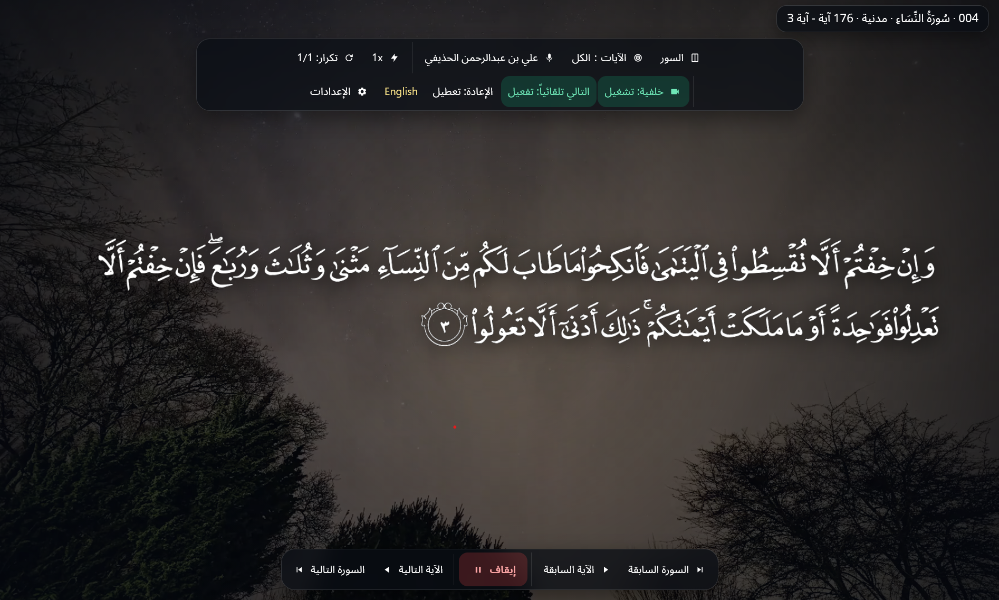

# Quran player



The TV page is the [alquran-cloud-local-UI](https://github.com/modestpharaoh/alquran-cloud-local-UI) player, copied into this integration. The original repository is not modified from here. Home Assistant serves the copy and opens it on the TV. After that, the TV owns playback.

Files live in `custom_components/alquran_cloud/www/kiosk/`. `QuranKioskView` in `kiosk.py` serves them with `requires_auth = False` at:

```
/api/alquran_cloud/kiosk/
/api/alquran_cloud/kiosk/{path}
```

No Home Assistant login. A TV browser launched by `system.launcher/open` or ADB does not have an HA session cookie. Paths that escape the kiosk directory (`..`) are rejected. HTML, JS, and CSS responses send `Cache-Control: no-cache` so a TV picks up a new script without a manual cache clear. The background video is large and is not marked that way.

The page is still unauthenticated. `QuranKioskView.get` allows the request only when `request.remote` is loopback (`127.0.0.1` or `::1`), an address on an enabled Home Assistant network adapter, or covered by an option below. Everyone else gets 403. The check uses `request.remote` only. Home Assistant already rewrites that value when a trusted proxy is configured.

With both options left at their defaults, a public address, Nabu Casa, and any other LAN are refused. A Docker bridge install whose only adapter is `172.17.0.0/16` refuses a `192.168` TV until one of the options is turned on.

- **Also allow private addresses** (`kiosk_allow_private`, default off). When on, any private address is enough, including RFC1918 and IPv6 unique-local addresses. Public addresses stay refused.
- **Extra trusted subnets** (`kiosk_trusted_networks`, default empty). Comma, space, or newline separated CIDRs such as `192.168.50.0/24` or `10.8.0.0/24`. A single address is a host route. Invalid text is an options error and is not saved. `0.0.0.0/0` and `::/0` are rejected. Any other valid subnet is trusted, including a public one, because that is an explicit choice.

If the network component has no addresses, only loopback and these options apply. The speaker URL `/api/alquran_cloud/media/{token}/…` is unchanged.

The page address always has a trailing slash before the query string:

```
http://ha.lan:8123/api/alquran_cloud/kiosk/?surah=2&ayah=1&reciter=ar.alafasy&speed=1&repeat=1&auto_surah=true&loop=false&language=en&background_video=false
```

Relative URLs such as `assets/bismillah.png` and `js/app.compat.js` then resolve under `/api/alquran_cloud/kiosk/`. Without the slash they would resolve under `/api/alquran_cloud/` and 404. The background video is a `<video>` tag with that relative path, which is why it played even when the script did not.

## Address parameters

Built by `build_kiosk_url`:

| Parameter | Meaning |
| --- | --- |
| `surah` | 1–114 |
| `ayah` | First ayah |
| `to_ayah` | Last ayah. Omitted when the range already runs to the end of the surah |
| `reciter` | Al Quran Cloud edition id, such as `ar.alafasy` |
| `speed` | `0.5`, `0.75`, `1`, `1.25`, `1.5`, `1.75`, or `2`. `1.0` is written as `1` |
| `repeat` | 1–20 |
| `auto_surah` | `true` turns on auto-next. `false` turns it off. A missing value uses the saved choice, which starts off |
| `loop` | `true` turns on loop. `false` turns it off. A missing value uses the saved choice, which starts off. With auto-next off, loop replays the opened surah or range. With auto-next on, loop wraps from surah 114 back to surah 1 |
| `language` | `en` or `ar`. A missing value uses the saved choice, which starts as English |
| `background_video` | `true` plays the landscape clip. `false` pauses it and hides it. A missing value uses the saved choice, which starts off |

A value in the address replaces the saved choice. `false` turns auto-next and loop off. The page used to paint auto-next as on in the HTML even when `auto_surah=false`, so the control looked enabled while playback stopped at the end of the surah.

The player reads those values once at load. When the address includes a `control` ticket, the page keeps asking Home Assistant for a command and sends the current reciter, surah, ayah, playing state, auto-next, loop, background, repeat, and speed. That request does not reload the page. A command is play, pause, next, previous, next ayah, previous ayah, next surah, previous surah, report, or settings. The ayah and surah commands press those buttons on the page. `next` and `previous` still follow the page’s ayah-or-surah setting. `report` leaves the clip where it is. `settings` carries auto-next, loop, background, repeat, and speed. A change on the page is reported on the next request, and a change on the card is applied on the page without a reload. Older TVs ignore a speed other than 1× and keep reporting 1. The ticket is not a Home Assistant login. A public address is still refused.

The browser stores the last surah, ayah range, reciter, speed, repeat, background, auto-next, loop, and language. A parameter in the address replaces the saved value and is written back, and the address is updated to match. Opening the page with no query restores the saved choices. Moving to another surah stores that surah. A launch that includes `surah` or `ayah` and omits `to_ayah` means the range runs to the end of the surah, which is how Home Assistant opens a full surah. Reset settings returns the saved choices to English, surah 1, ayah 1, Alafasy, speed 1, repeat 1, and turns auto-next, loop, and the background off. Favorites and the cache period reset with them. Downloaded audio is kept. An old TV still plays at 1×; a speed saved from the address is kept for a browser that can use it.

The space bar toggles play and pause. It still types a space in a text field. Play, pause, and play/pause keys are honored when the TV browser delivers them: LG webOS sends 415 and 19, Samsung can register `MediaPlay`, `MediaPause`, and `MediaPlayPause`, and Android uses those keys plus the Media Session play and pause actions. A stop key pauses the recitation. Next and previous track keys move one ayah. Settings can switch those same keys to the next and previous surah, and reset returns that choice to the ayah. Rewind, fast-forward, and the arrow keys are left for the TV. Escape and the TV Back key close the surah, reciter, ayah range, repeat, and settings windows. Back still leaves the page when no window is open.

## What the page loads

Surah text, ayah lists, and reciters come from `https://api.alquran.cloud`. Ayah audio and ayah images come from `https://cdn.islamic.network`. Those hosts are HTTPS. The Home Assistant page itself may be HTTP on the LAN. The CDN does not send CORS headers. An `<audio>` or `` element can still load those URLs. A `fetch()` from a service worker cannot read them, and a `no-cors` response is opaque.

The ayah that is playing stays a direct CDN file. While it plays, the page asks Home Assistant for the next ayah only. Home Assistant fetches that one MP3 from the CDN and passes the bytes to the TV. The page holds that single file in memory and starts it when the current ayah ends, so the TV does not wait for a new CDN connection. If the next file has not arrived yet, the page plays the CDN address as before. Home Assistant does not keep the recording. The ayah picture is the high-resolution CDN image on every TV, and the next picture starts loading during the current ayah.

Play and pause follow the audio element, including when webOS pauses the clip itself and only then delivers the key. The play and pause marks are chosen by the button’s playing state, because the SVG `hidden` attribute does not change what this browser draws. Next and previous are also read on key release, which is when some webOS sets deliver those media keys. The LG remote often does not deliver those keys to the page. The card’s six buttons reach the page through the control ticket on every TV, including Android. A physical remote’s media keys remain reliable on Android and often do not arrive on LG webOS or Samsung.

Bismillah (the opening image and a short clip) plays for ayah 1 of every surah except surah 1 and surah 9. The image file is `assets/bismillah.png` and is also the initial `src` of the ayah image, same as the video tag, so it appears even if the script is slow.

## Service worker

`sw.js` was written for a site served at the origin root (`http://127.0.0.1:8080/`). Under Home Assistant the page is not at `/`.

The first install tried to precache `new URL('/assets/bismillah.png', self.location.href)`. A leading slash ignores the kiosk directory, so the request was `https://<ha>/assets/bismillah.png`, not `/api/alquran_cloud/kiosk/assets/bismillah.png`. `cache.add` never finished, `skipWaiting()` never ran, and `navigator.serviceWorker.ready` has no timeout in the original player. Startup waited forever, so the surah and reciter lists stayed empty. The next-surah button still worked because it was bound before that wait. A later reload could get past the wait, but the worker still intercepted any same-origin path ending in `/assets/bismillah.png` and answered with a bad or opaque response, so the image stayed broken. The background video kept working because the `<video>` tag had already started, and the video handler built a real response from the actual request URL.

The worker now:

- Calls `skipWaiting()` immediately and does not precache a root-absolute path.
- Does not answer `audio`, `image`, or `video` requests, and does not answer URLs that end in those media extensions. The media element loads the network response itself.
- Drops old `quran-kiosk-static-*` caches on activate.
- Registration in `app.js` gives up after about two seconds, and replaces a worker whose script URL is not `sw.js?v=3` once, then reloads.

Opaque worker responses are why webOS could show the lists and still play no audio. Desktop Chrome often plays them. webOS does not. Letting `<audio>` fetch `cdn.islamic.network` directly is the reliable path. Offline caching of those MP3s from the worker is not used for playback.

## webOS 4

webOS TV 4 (firmware 04.64.00) is Chromium 53. That engine parses ES2016 and does not parse `async`/`await` or `??`. `Element.append` and `replaceChildren` are also missing, and so are flex `gap`, CSS grid, and `min()`.

The video tag did not need any of that, so the background played. The script never ran, so the surah request never started and the ayah image kept an empty `src`, which this browser shows as a broken image.

The page loads three scripts, in order:

1. `js/legacy.js` — small polyfills for `append`, `replaceChildren`, and `NodeList.forEach`, written without modern syntax.
2. `js/kiosk-lib.compat.js` — `js/kiosk-lib.js` downleveled to Chrome 53.
3. `js/app.compat.js` — `js/app.js` downleveled to Chrome 53.

`index.html` does not load `app.js` or `kiosk-lib.js` directly. Edit those, then rebuild:

```bash
npm install
npx esbuild custom_components/alquran_cloud/www/kiosk/js/kiosk-lib.js \
  --target=chrome53 \
  --outfile=custom_components/alquran_cloud/www/kiosk/js/kiosk-lib.compat.js
npx esbuild custom_components/alquran_cloud/www/kiosk/js/app.js \
  --target=chrome53 \
  --outfile=custom_components/alquran_cloud/www/kiosk/js/app.compat.js
```

`oldTvBrowser()` is webOS with Chrome older than 80 (webOS 4, 5, and 6), and older Samsung sets: Tizen before 6.5, or a SmartTV browser that does not name a Tizen version and whose Chrome is missing or older than 80. Many of those Samsung user agents never include `Chrome/`, so the Tizen version is what decides. Tizen 6.5 and newer stay on the normal path. The worker is not registered for these old browsers. Newer webOS can register it. The worker still does not sit in front of audio or images.

`system.launcher/open` is not a user gesture, so the first `audio.play()` is often rejected. The page remembers that and retries on the next click or remote key, calling `load()` and `play()` in that handler.

webOS 4, 5, and 6, and Samsung sets from before Tizen 6.5, never load the landscape video. Those browsers will only run one media element, so a clip behind the ayah audio stops after a few seconds and does not loop. With the background on, they crossfade the six JPEG frames in `assets/bg/` instead. The frames do not use the media decoder, so they keep changing under the recitation. A PC, Android TV, or Tizen 6.5 and newer still gets the 1080p clip. The page sets that file as the video source only for those browsers, and restarts it from the start when it ends.

Playback speed is locked to 1× on those same old TVs. The decoder ignores `playbackRate` without throwing, and this Chrome has no pitch-preserving rate change. The speed button is hidden, and a `speed=` value in the address is ignored. The dashboard card still offers other speeds for speakers and for newer browsers.

CSS that Chromium 53 ignores is given a fallback under `@supports not (gap: 1px)`: button margins, and surah cards as inline blocks instead of a grid.

webOS 4 has no emoji font. Toolbar, transport, and favorite marks are inline SVG, so the reciter microphone and the other controls still draw. In Arabic the skip icons are mirrored: previous points right and next points left. Play and pause swap by setting the SVG `hidden` attribute. Assigning the `hidden` property on an SVG does not change that attribute in this browser.

The page uses Noto Sans Arabic for Latin and Arabic. The TV’s own font draws lam-alef and hamza alef as separate letters, so words such as السور and الإعدادات fall apart. Letter spacing on Arabic is left at 0 for the same reason.

A surah is named with its number, name, ayah count, and Meccan or Medinan, in that order, on the info bar and in the surah list. English is `001 · Al-Faatiha · 7 ayahs · Meccan`. Arabic is `002 · سُورَةُ البَقَرَةِ · 286 آية · مدنية`. The count word follows the last two digits: 3–10 uses آيات, 2 uses آيتان, and every other ending uses آية. The current ayah stays after that title. The title and the control buttons step up at 1600px, 2200px, and 3200px wide, so a 4K panel is larger than a 1080p one.

## Decisions

- Serve the existing player from Home Assistant. Do not generate an MP4.
- The page reports the reciter, surah, ayah, and playback settings on its control poll. It does not report a media position, and Home Assistant does not advance the ayah from the TV’s media player.
- The page must work in a subdirectory, so asset URLs are relative to `/api/alquran_cloud/kiosk/` and the address keeps its trailing slash.
- Do not block first paint on the service worker, and do not let the worker answer media elements.
- webOS 4 gets a Chrome 53 build plus a few DOM polyfills, and does not get a service worker.
- The bismillah image is in the HTML, like the background video, so it does not depend on the script.
